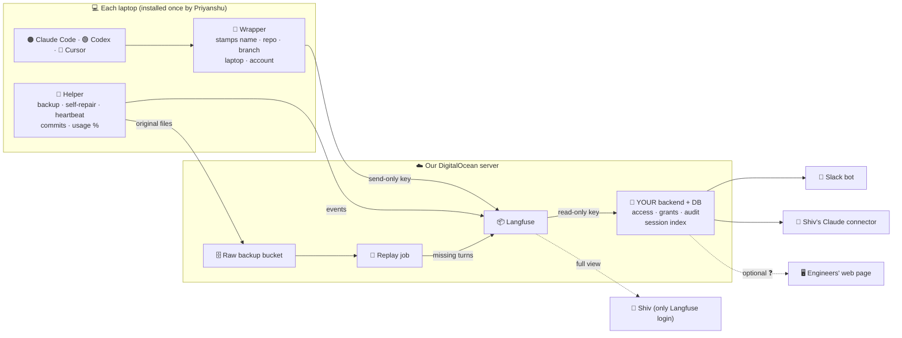
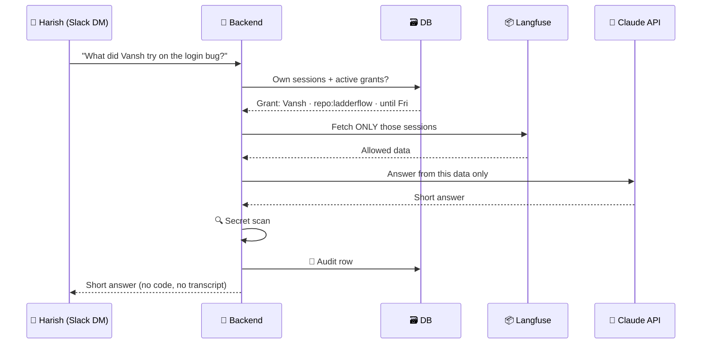

# 🔭 Agent Session Observability: The Plan (for Harish)

> **Hi Harish 👋** This explains Shivam's task, the solution we chose, the problems we found, and **your part** in detail.
> Everything was checked on **17 Oct 2026** against official docs and source code. We also opened the real session files on one of our laptops.
> 📄 A longer reference version with every detail: `Langfuse Explained - Agent Session Observability.md`

**Labels:**

- ✅ verified
- 🔎 works today, but not officially documented
- 🧪 must test in the pilot
- 📐 estimate
- ❓ open

---

## 1. 🎯 What Shivam asked for

**The ClickUp task:** "Agent session observability PRD". It's assigned to **Priyanshu and you**, due **end of October**.

**The problem:** the 4 engineers (Vansh, Priyanshu, Harish, Rishab) do most of their work with AI. Shivam can't see any of it, and commits alone don't show enough.

**The goal:** record **every** AI coding session from **Claude Code, Codex (CLI + IDE extension) and Cursor**. Shivam can then ask about any of it from **Slack** or from **his Claude**, for example *"what did Vansh do on LadderFlow this week?"*.

**He wrote 2 versions of the spec:**

- 🏗️ **Original (15 Oct):** build everything ourselves.
- 🧩 **Revised (16 Oct, current):** use **self-hosted Langfuse** for recording and storage. We build only the missing parts.

**His fixed rules:**

1. 🙅 **Zero developer effort** after a one-time install.
2. 💾 **Raw data kept** forever.
3. 👑 **Only Shiv sees everything**; everyone sees their own.
4. 🔒 **Data only on our DigitalOcean.**
5. 🤏 **Slack gets short answers**, never code or transcripts.
6. 🚫 **Nothing written into client repos.**
7. 📢 **Team told before install.**

---

## 2. ✅ The solution in one picture

> 🧩 **Langfuse = recorder + library.**
> 🛡️ **Our backend = security guard.**
> 🛟 **Our laptop helper = safety net.**

### Why Langfuse

- It's the only **free, self-hosted, mature** tool with **official recorders for all 3 tools**.
- **LangSmith:** self-hosting is paid Enterprise only.
- **Laminar:** no Cursor recorder, and its self-hosted Slack needs a paid key.
- **Smaller tools:** too young.

### Why not Enterprise

- **No Langfuse edition can limit a user to their own sessions.** Enterprise only adds per-*project* roles ✅.
- The rest of what Enterprise adds (audit logs, server-side secret removal, retention rules, SCIM) is either covered by our backend or not needed.
- 👉 **Free self-hosted + our backend covers the whole spec.**

### Why not build everything ourselves

- It would take **~25–40 days** 📐, versus **~14** with Langfuse.
- The hardest problems (hook bugs, undocumented file formats) come from the **AI tools themselves**, so building our own wouldn't remove them.

---

## 3. 📦 What Langfuse gives us, and what it doesn't

| ✅ Langfuse gives (free)                                                    | ❌ Langfuse doesn't give, so we build it                                     |
| --------------------------------------------------------------------------- | ---------------------------------------------------------------------------- |
| Recorders for all 3 tools: prompts, answers, tool calls, sub-agents, tokens | **Per-person access**, which no edition has                            |
| Storage, kept forever by default                                            | **Temporary access (grants)**                                          |
| Web screen for Shiv: sessions, users, search, dashboards                    | **Who-viewed-what audit log**                                          |
| Send-only + read-only keys (after 2 settings)                               | **Slack Q&A + daily digest** (its Slack integration only sends alerts) |
| Cost estimate (built-in price list)                                         | **A proper connector for Shiv's claude.ai**                            |
| Alerts to Slack/webhook                                                     | Zero-touch install, backup, self-repair, commits, usage %                    |
| API + MCP server, no rate limits                                            | Recovery of lost sessions (replay)                                           |

---

## 4. 👥 Who builds what

| 🟠 **Priyanshu** (laptop + server)                    | 🔵 **Harish** (everything people use)     |
| ----------------------------------------------------------- | ----------------------------------------------- |
| ⚙️ Langfuse server, settings, keys, backups               | 🗃️ Backend database + **access rules**  |
| 🧑‍💻 One-time installer (`obs-install`)                 | 🔄 Sync job + session index                     |
| 🧩 Wrapper (stamps name, repo, account)                     | 💬 Slack bot: Q&A, grants, audit, digest        |
| 🛟 Helper: backup, heartbeat, self-repair, commits, usage % | 🔌 Shiv's Claude connector (our own MCP)        |
| 🔁 Replay job (recovers lost sessions)                      | 🚨 Slack posting for alerts (ERROR → RESOLVED) |
| 👀 Uptime monitor                                           | 🖥️ Optional web page ❓                       |

---

## 5. 🔵 Your part in detail

### 5.1 🔑 How you read the data

- You get **one Langfuse key with "Viewer" (read-only) permission**. It lives **only on the server** and never goes to a browser, Slack or a laptop.
  - That key **can read every developer's sessions**, which is why **your code** must enforce access.
- **Endpoint:** `GET /api/public/v2/observations` ✅
  - **Filters:** `userId`, `sessionId`, `name`, `traceId`, `type`, `environment`, `fromStartTime`, `toStartTime`. Tags and metadata go through the JSON `filter` parameter.
  - **Pages:** up to **1,000 per page**, with cursor paging.
  - **Text search:** `matches` on input/output does **whole-word search** (not fuzzy, not substring) ✅.
- ⚠️ On a fresh v4 install, the old `/traces`, `/sessions` and `/observations` endpoints return **404** ✅. There is **no "list sessions" endpoint**, so you group observations into sessions yourself.
- Self-hosted has **no rate limits** ✅.

### 5.2 🔄 Sync job and session index (every 2–5 min)

Pull new observations, then **group them by `sessionId`** into our own `sessions` table. That table is what answers questions like "stuck sessions", "sessions over 2 hours with no commit", "Vansh's week" and the digest, without hitting Langfuse every time.

### 5.3 🗃️ Database tables (small Postgres on the same server)

| Table                             | Holds                                                                                                                |
| --------------------------------- | -------------------------------------------------------------------------------------------------------------------- |
| `people`                        | Name, Slack ID, emails, admin flag (**Shiv only**)                                                             |
| `machines`                      | Laptop ID, owner, last heartbeat, tool versions, tamper events                                                       |
| `sessions`                      | Chat ID, tool, person, account, plan, repo, branch, start/end, turns, tokens, cost estimate, usage % change, summary |
| `commits` / `session_commits` | Commits and their linked session, with a **confidence level**                                                  |
| `usage_snapshots`               | Account %, window, reset time, chat ID, time                                                                         |
| `grants`                        | Grantee, scope (person / repo / product / one session), expiry, reason, given by, revoked                            |
| `audit_log`                     | Every question or page view: who, what, which sessions                                                               |
| `repo_products`                 | Repo → product mapping                                                                                              |
| `alerts`                        | Open/resolved errors, owner, Slack thread                                                                            |

### 5.4 🛡️ The access rule (most important)

> 🔐 **The AI only ever *sees* data the person is allowed to see.**
> We never give Claude everything and say "only show Harish his own"; an AI can't keep secrets it can already see.

**Who may see what:**

- 👑 **Shiv** may see everything.
- 👤 **Everyone else:** their own sessions + sessions covered by an active grant.
- **Your code** works out that list **first**, fetches **only those sessions**, and only then passes them to Claude.
- **Tests must prove it:** Harish asking about Priyanshu's work without a grant gets **nothing**.

### 5.5 💬 Slack bot

- **Where it works:** DMs and private channels **only**. It ignores public channels.
- **Answers:**
  - **Short.** Shiv's answers link to Langfuse; everyone else gets summaries.
  - **Never** pastes code, client data or transcripts.
  - **Every reply passes a secret scanner** (gitleaks or detect-secrets style rules).
- **🎟️ Grants (temporary access):**
  - **What a grant means:** read-only access to another engineer's **recorded** sessions for a limited time. Example: you take over a bug Vansh worked on.
  - **Command:** `/obs grant @harish repo:ladderflow 7d <reason>` works **only from Shiv's Slack ID**. Shiv gets **Confirm / Cancel** buttons, and the grantee gets a DM listing what they can see and until when.
  - **Ending a grant:** it expires automatically. There's also `/obs revoke` and `/obs grants`.
- **📝 Audit:**
  - **What's saved:** one row per question: who asked, what, which sessions.
  - **Who can see it:** Shiv, by asking the bot, e.g. "who looked at Vansh's sessions this week?".
- **🏷️ Mapping:** Shiv says "ladderflow-api is LadderFlow", and the bot confirms.
- **☀️ Daily digest, 9:00 IST, to Shiv:**
  - a health line
  - one line per developer
  - one line per product
  - a "needs a look" list
- **⚡ Activity alerts:**
  - a laptop silent for 24h while its owner is committing
  - a tamper event
  - a session over 2h with no commit
- **Suggested models 📐:** Claude Sonnet 5.5 for answers, Claude Haiku 5.5 for session summaries.

### 5.6 🔌 Shiv's Claude connector (our own MCP)

**Why we build our own:** Langfuse's built-in MCP has three problems.

- It **only accepts a key, with no normal login** ✅. claude.ai supports that only through a **beta** feature ✅.
- It only has low-level "observation" tools, with **no sessions tool** ✅.
- It turns on **write tools by default** ✅.

**What we build:**

- A small MCP server (streamable HTTP + **OAuth login**). It works in claude.ai, desktop and Claude Code, and **only Shiv can sign in**.
- **Tools:**
  - `search_sessions`
  - `get_session`
  - `developer_activity`
  - `product_changes`
  - `commit_provenance`
  - `stuck_sessions`
  - `machine_health`
  - `usage_summary`
- **How it gets data:** it runs on the **same backend**, so the same rules and audit log apply.
- **The test:** Claude answers "what did Vansh do on LadderFlow this week" with links.

### 5.7 🚨 Error alerts (you build the Slack side)

Every check writes a row to `alerts`. You post it to Shiv's DM:

1. a red **ERROR** label, what broke, what it affects, and the **owner tagged**
2. repeats go into the **same thread**
3. **RESOLVED** in that thread once the check passes again

| What breaks                                                          | Owner                                                       |
| -------------------------------------------------------------------- | ----------------------------------------------------------- |
| Claude API credit, spend cap, rate limits                            | Priyanshu                                                   |
| Langfuse down, or no sessions for 1h in work hours                   | Priyanshu                                                   |
| Disk, bucket or backups                                              | Priyanshu                                                   |
| Laptop silent, tamper, helper crash, recorder broken after an update | Priyanshu                                                   |
| **Bot / backend** fails, **connector** sign-in breaks    | **Harish**                                            |
| Server or bot fully down                                             | An **outside uptime monitor** posts through a webhook |

Two extras:

- The digest opens with one health line: "all systems working" or "N open errors".
- ⚠️ If Langfuse alerts call your backend on a **private address**, Priyanshu must allow it with the `LANGFUSE_WEBHOOK_WHITELISTED_HOST` setting ✅.

### 5.8 🖥️ Optional: engineers' web page ❓

**The idea:** engineers log in with **"Sign in with Slack"** and see **My sessions**, plus granted ones with an expiry banner. Every page view goes into the audit log. It runs on the **same backend**, and the Langfuse key never reaches the browser.

**Effort:** 📐 **+3–4 days.**

⚠️ **Needs Shivam's OK first:** his revised spec says developers get **summaries in Slack only**.

---

## 6. 🟠 What arrives from Priyanshu's side (so you know your data)

**The installer** writes **system-level settings** for each tool, so they apply to every folder and login and developers can't override them:

- Claude: `managed-settings.json` ✅
- Codex: `requirements.toml`, where hooks are "trusted by policy" so there's no approval pop-up ✅/🧪
- Cursor: system `hooks.json` 🧪

**The wrapper** stamps each session with the developer name, repo, branch, laptop and account. The Codex recorder doesn't record repo or branch by itself.

**The helper** runs as a system service:

- **raw backup** of the original chat files
- **heartbeat** every 15 min
- **self-repair** every hour, with a tamper alert
- **commit reader** every 5 min
- **account/plan** check every hour
- **usage %**

**The replay job** runs on the server. It compares the raw backup with Langfuse and re-sends missing turns 🧪. That covers:

- offline laptops
- failed uploads
- the **Codex VS Code bug**

### 📋 Data conventions: let's agree on these on Day 1 (proposal)

| Field         | Value                                                                                                                               |
| ------------- | ----------------------------------------------------------------------------------------------------------------------------------- |
| `userId`    | Developer name: `priyanshu`, `harish`, `vansh`, `rishab`                                                                    |
| `sessionId` | The tool's own chat ID (set by the recorders)                                                                                       |
| Tags          | `tool:claude-code` / `tool:codex` / `tool:cursor`, `repo:<name>`, `machine:<id>`                                          |
| Metadata      | `account_email`, `plan`, `branch`, `machine_id`                                                                             |
| System events | `git-commit`, `usage-snapshot`, `heartbeat`, `tamper`, tagged **system** so they stay out of Shiv's session screen 🧪 |

Day 1 also needs two decisions:

- Priyanshu installs on his own laptop first, so you have **real data** from day 1.
- ❓ **Who creates the laptop keys?** Only Shiv has a Langfuse login, so either Shiv creates them or Priyanshu uses the vault admin account.

---

## 7. ⚠️ Problems we found and how we solve them

| #  | Problem                                                                                                    | Solution                                                                                                                                                                              |
| -- | ---------------------------------------------------------------------------------------------------------- | ------------------------------------------------------------------------------------------------------------------------------------------------------------------------------------- |
| 1  | 🔑 By default **every Langfuse key can read everything**, so a laptop key could read all sessions ✅ | Turn on `API_AUTH_MIGRATION=enforce` + `API_KEY_PROJECT_ROLES_ENABLE=true`, create new **send-only** laptop keys and a **read-only** key for you, delete the old keys |
| 2  | 👥 No per-person access in any edition                                                                     | **Your backend** enforces it (5.4)                                                                                                                                              |
| 3  | 🟢 Langfuse's normal Codex install makes every developer **approve the hook**                        | System-level `requirements.toml`, which needs no approval                                                                                                                           |
| 4  | 🐞 **Codex hooks often don't fire in the VS Code extension** (open OpenAI bug #33413)                | Codex still writes complete chat files (checked), so **replay** recovers them                                                                                                   |
| 5  | 📴 Claude and Cursor recorders **drop turns when offline**                                           | Raw backup + replay                                                                                                                                                                   |
| 6  | ✂️ Claude and Cursor recorders cut one piece of text above **20k characters**                      | The full original stays in the raw backup                                                                                                                                             |
| 7  | 🔗 **Husky** repos override a global Git hook, so commits would be missed                            | The helper **reads commits directly** (`git reflog`). No Git hook, nothing in the repo.                                                                                       |
| 8  | 🔗 Commit → session matching can be a guess                                                               | Show **confidence**: ✅ strong (same files edited), ⚠️ likely (same person, repo, time), ❓ guess (two sessions overlapped)                                                   |
| 9  | 🧠 Langfuse's MCP is key-only with no sessions tool                                                        | Our own MCP (5.6)                                                                                                                                                                     |
| 10 | 🪟 Claude recorder **unproven on native Windows**                                                    | The wrapper calls it directly; test in the pilot                                                                                                                                      |
| 11 | 🔒 Secrets typed into chats get **stored** (server-side removal is Enterprise-only)                  | Slack replies are scanned. Removing secrets on the laptop isn't designed yet ❓                                                                                                       |

---

## 8. 📈 Accounts, tokens, price and usage %

**What we checked on a real laptop:**

|                      | 🟠 Claude Code                                                                | 🟢 Codex                                                  |
| -------------------- | ----------------------------------------------------------------------------- | --------------------------------------------------------- |
| Chat files           | One `.jsonl` per chat in `~/.claude/projects/`                            | One `.jsonl` per chat in `~/.codex/sessions/`         |
| Exact tokens         | ✅ per reply                                                                  | ✅ per reply, per turn, running total                     |
| Usage % in chat file | ❌ not saved (only one overwritten account snapshot in `~/.claude.json` 🔎) | ✅ after every reply: % used, window, reset time, plan 🔎 |
| Account + plan       | 🔎 `~/.claude.json`                                                         | 🔎 login token in `~/.codex/auth.json`                  |
| % precision          | Whole numbers                                                                 | Whole numbers; this plan showed a weekly window only      |

**What this means for you:**

- 📈 **Usage % is per account**, not per chat. We store snapshots before and after each reply.
- A chat's share is **exact only when one chat ran alone**. Overlapping chats are split by cost and labelled ⚠️. Increases with no active chat show as "other usage" (e.g. claude.ai).
- 🔢 **Exact tokens are the reliable per-chat number.** Show those first.
- 🟠 Claude's % comes from a small status-line script, **Pro/Max only**. 🔵 Cursor has no % anywhere.
- 💲 **No real price exists for subscriptions** (fixed fee, no per-prompt bill). Langfuse's "$" is an **API-equivalent estimate**, so label it that way.
- 🪪 On our test laptop, Claude Code and Codex used **two different personal accounts**, so store the account **per tool**.

---

## 9. ❓ Still open

**Must test in the pilot 🧪:**

- the Codex and Cursor system-level install
- replay (incl. Codex VS Code) **without duplicates**
- native Windows
- send-only keys with every recorder
- the Claude status line inside the IDE
- the experimental Cursor recorder
- DigitalOcean Spaces as Langfuse storage

**Needs design:**

- removing secrets on the laptop
- upload-only bucket keys (does Spaces support them?)
- who creates laptop keys
- an alert when a tool update changes its file format

**Shivam decides:**

- 🖥️ engineers' web page vs Slack summaries only
- 🪪 personal vs company accounts (privacy)
- ⏱️ timeline (~14 days vs 6 in his spec)

---

## 10. 🧪 Tests you own

- [ ] Harish **without a grant** gets his own sessions, **nothing of Priyanshu's**, and **can't log into Langfuse**
- [ ] A 1-day grant works, then **disappears** the next day
- [ ] **Every question** appears in the audit log
- [ ] A fake API key typed into a prompt **never appears in Slack**
- [ ] A commit made during a session is linked to it, with the right confidence
- [ ] The bot stopped / connector broken raises an **ERROR within 15 min**, then RESOLVED
- [ ] Shiv gets the **same answer** in Slack and in Claude
- [ ] The digest shows the **health line** at the top

---

## 📚 Key sources

- **Langfuse:**
  - [Free vs Enterprise](https://langfuse.com/pricing-self-host)
  - [Key permissions](https://langfuse.com/docs/administration/rbac)
  - [Public API](https://langfuse.com/docs/api-and-data-platform/features/public-api)
  - [MCP](https://langfuse.com/docs/api-and-data-platform/features/mcp-server)
  - [Alerts](https://langfuse.com/docs/observability/features/alerts)
  - [OpenTelemetry](https://langfuse.com/integrations/native/opentelemetry)
- **Claude Code:** [Managed settings](https://code.claude.com/docs/en/managed-settings) · [Status line](https://code.claude.com/docs/en/statusline)
- **Codex:** [Hooks](https://learn.chatgpt.com/docs/hooks) · [IDE bug #33413](https://github.com/openai/codex/issues/33413)
- **Cursor:** [Hooks](https://cursor.com/docs/hooks)
